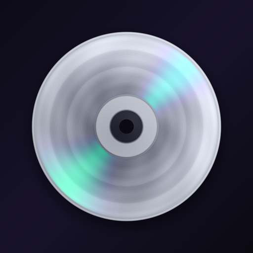

<div align="center">



# Unnamed: the free, open-source music WIP tracker for Mac

*A free alternative to [untitled] and other subscription apps for works in progress. Also: admittedly, completely, 100000% slopcode. Just absolute garbage code. But it's free so enjoy it i guess.*

**Every demo, voice memo, bounce and beat in one place. Keep every version, leave timestamped comments, find songs by key and BPM, and sync through your own iCloud Drive. No subscription, no servers, no lock-in.**


[**⬇ Download for Mac**](https://github.com/michdooley/Unnamed/releases/latest) · [Website](https://michdooley.github.io/Unnamed/) · [How it compares](#unnamed-vs-untitled) · [Install help](#download-and-install) · [Build it yourself](#build-it-yourself)

[](https://github.com/michdooley/Unnamed/releases/latest)
[](#download-and-install)
[](LICENSE)
[](#build-it-yourself)
[](#yes-its-1000-vibecoded)

</div>

<!--
  MEDIA: the hero. A 20–40 second screen recording works best: drop a few
  demos in, play one, scratch the disc, open a moodboard. To add a video,
  edit this file on github.com and drag the .mp4 in here (GitHub hosts it and
  plays it inline). Keep the screenshot below as a fallback, or replace it.
-->


## A home for unfinished music

Songwriters, producers and bands make a lot of unfinished music: voice memos of a melody, bounces from the DAW, a rough mix to send the band, the "final" master that's actually version 7. **Unnamed is a music work-in-progress (WIP) tracker** that keeps all of it organized, playable and commented, on your Mac.

Apps like [untitled] do this beautifully, but your music lives on their servers, and more storage and the pro tools need a monthly membership. Unnamed is the opposite deal:

- **Free and open source.** MIT licensed. No account, no subscription, no ads, no tracking.
- **Your files, your folder.** Your library is a plain folder of audio files and small text files. Open it in Finder, back it up, take it with you. Nothing depends on this project surviving.
- **Syncs through what you already have.** Keep the library in iCloud Drive (recommended) and it follows you to your other Macs. Dropbox, Google Drive, OneDrive, Syncthing and Nextcloud work too.
- **Nothing trains on your music.** There's no server to upload to.

## Features

<!-- MEDIA: one screenshot or short clip per heading below works well. -->

### Collections, folders and an archive
Organize demos into **collections**: albums, EPs, mixtapes, beat packs, sets of sketches. A song can live in several collections at once. File collections into **folders** as deep as you like. **Archive** anything to hide it without deleting it, and restore it to exactly where it was.

### Version history for every song
Upload a new bounce and the old one is kept. Play any version, name it ("rough mix", "with vocals", "master v3"), make an older one current again, or export it. Comments stay attached to the version they were made on.


### Waveform player with timestamped comments
A floating player with a scrubbable waveform, queue, shuffle and repeat. Media keys and Control Center work. Start typing while a song plays and your comment pins to that moment. Comments show as markers on the waveform; click one to jump there. Per-song **notes** hold lyrics, chords and to-dos.

### Automatic key and BPM detection
Drop in a song and Unnamed listens for its **tempo and key** in the background, so you can search for "128" or "F♯ minor". Anything you type yourself always wins. The detector is built in and measured against real recordings ([details](#how-accurate-is-the-key-and-bpm-detection)).

### Moodboards for concept albums
Flip a collection into an infinite **moodboard**: lay songs out as glass threads, add pictures, videos, text and drawings, and press **Play Journey**. The view travels along the threads as the music plays, a storyboard for your album.

<!-- MEDIA: docs/images/moodboard.mp4 (a Play Journey clip) -->

### DJ scratching (yes, really)
Grab the spinning CD, or drag along the waveform, and the music follows your hand, backwards and all. Let go and it spins back up in time.

<!-- MEDIA: docs/images/scratching.mp4 -->

### Made for macOS
SwiftUI and **Liquid Glass** on macOS 26, with album colours flowing into the window. Spinning CDs drawn by a Metal shader. Import WAV, MP3, AIFF, M4A/AAC, FLAC, CAF and anything else macOS plays. Drag songs straight into Finder or your DAW. A **Low Power Mode** keeps it light on battery.

<details>
<summary><b>The full feature list</b></summary>

- **Import** WAV, MP3, AIFF, M4A/AAC, FLAC, CAF, or anything else macOS can play. Use the Add Tracks button, drag files or whole folders into the window, drop them on the Dock icon, or use Open With.
- **Collections**: albums, EPs, mixtapes, sets of sketches. A track can be in several collections. Reorder by dragging, add tracks you've already uploaded, and move or duplicate tracks between collections.
- **Folders** for organizing collections, nested as deep as you like. Drag things into folders in the sidebar or on a folder's page.
- **Version history**: upload a new version of a track and the old ones are kept. Play any version, name it, make it current again, or export it. Comments belong to the version they were made on.
- **Artwork** for collections and individual tracks: upload an image, drop one on the cover, or pick a photo from **Unsplash** (the photographer is credited). Tracks without their own art take on their collection's look.
- **Waveform player**: scrubbable waveform, play/pause, next/previous, shuffle, repeat (all/one), volume and an up-next queue. Media keys and Control Center work too.
- **Timestamped comments**: start typing while a track plays and the comment pins to that moment and version. Comments show as markers on the waveform; click one to jump there.
- **Notes** per track, for lyrics, chords and to-dos.
- **Key and BPM detection**: tempo and key are worked out from the audio when a song or a new version is added. Typed values always win. Edit Track has "Detect from Audio", plus ½× and 2× for when a tempo lands on half or double time. File › Find Missing Keys and Tempos fills in older tracks.
- **Moodboards**: an infinite dot-grid canvas per collection. Songs become glass threads you can bend; add pictures and videos (compressed to HEIC and HEVC), text and drawings; pick the background. **Play Journey** follows the threads as the music plays. ⌘-scroll or pinch to zoom.
- **Scratching**: grab the disc in the player (or the record behind a collection's cover), or drag along the waveform, and the music follows your hand like a DJ's.
- **Archive** tracks, collections and folders: out of sight, not deleted, and restored to exactly where they were.
- **Search** across titles, file names, notes, comments, key and BPM.
- **Sync** through iCloud Drive, or any folder Dropbox, Google Drive, OneDrive, Box, Syncthing or Nextcloud keeps. Songs still in the cloud show a badge and download when played; "Make available offline" and "Remove download" manage space.
- **Export** a track (or any version), or a whole collection as numbered files. Drag a track straight into Finder or your DAW.
- **A Metal welcome screen**: slowly spinning CDs drawn per pixel with a small diffraction model, whose rainbow sheen follows your mouse.
- **Liquid Glass** (macOS 26, Settings › Appearance): glass player and buttons, artwork colours in the window, and a "+" that melts out of the player.
- **Light on the CPU**: animations run in Core Animation, so playing music costs a few percent of one core. **Low Power Mode** (Settings › Energy) tones things down further, automatically when your Mac is in Low Power Mode.

</details>

## Unnamed vs. [untitled]

| | **Unnamed** | **[untitled]** |
| --- | --- | --- |
| Price | Free, forever | Free tier; membership $7.99/month or $49.99/year |
| Where your music lives | A folder you own: iCloud Drive, Dropbox, any synced folder | Their cloud (with an offline mode) |
| Source code | Open (MIT) | Closed |
| Comments | ✓ Timestamped, per version | ✓ On projects and tracks |
| Apps | Mac | iPhone, desktop and web |
| Share links | Not yet | ✓ With access controls |
| Stem splitting, pitch and speed | ✗ | ✓ With a membership |

**What Unnamed adds:** named version history for every song, automatic key and BPM detection, notes, moodboards with Play Journey, DJ scratching, and a library of plain files you can open without the app, synced by whatever service you already use.

**Honest take:** [untitled] is a great product with a team behind it, apps for iPhone, desktop and the web, and share links for sending music to collaborators. If those matter most to you, use it. Unnamed is for people who'd rather own their files, not pay monthly, and don't mind an app that's young and a little weird.

*[untitled] details are from its App Store listing as of October 2026. Prices and features change; check their site for the current details.*

## Yes, it's 1000% vibecoded

No human wrote the code. Every line of Swift, the Metal shaders, the tests and most of this README were written by an AI ([Claude Code](https://claude.com/claude-code)), directed by a musician who knew what the app should feel like, tried every build, and sent it back until it did.

What that means for you:

- **It's tested by machines, not a QA team.** More than 100 automated tests cover the library format, sync, playback, scratching and key/BPM detection, but expect rough edges.
- **Your data is safe by design.** Your library is plain files in a folder you choose, so no bug can lock you out. Back it up like any folder.
- **Contributions are welcome**, vibecoded or not. Open an issue or a pull request.

## Download and install

1. Download **[the latest Unnamed .dmg](https://github.com/michdooley/Unnamed/releases/latest)**, open it, and drag **Unnamed** into **Applications**.
2. Open Unnamed. Because the app isn't notarized by Apple (that needs a paid developer account), macOS says it can't check it for malicious software. Click **Done**.
3. Open **System Settings › Privacy & Security**, scroll down to "Unnamed was blocked…", click **Open Anyway**, and confirm. You only do this once per download.

Prefer Terminal? `xattr -dr com.apple.quarantine /Applications/Unnamed.app` does the same.

Requires **macOS 15 Sequoia or later**, on Apple silicon or Intel. Liquid Glass needs macOS 26. When you install a new version, the app may ask you to point it at your library folder again the first time.

## FAQ

#### Is Unnamed really free?
Yes. It's open source under the MIT license, with no account, subscription, ads or tracking.

#### Is it a good [untitled] alternative?
For organizing, versioning, commenting on and listening to works in progress on a Mac, yes. It doesn't have an iPhone app or share links yet.

#### Where is my music stored?
In a folder you choose. Audio stays as the files you imported; collections, comments and notes are small JSON and Markdown files next to them ([the format](docs/LIBRARY_FORMAT.md)). You can read it all without the app.

#### Can I sync with Dropbox, Google Drive or OneDrive instead of iCloud?
Yes. Put the library in any folder those services (or Syncthing, Nextcloud, a network drive) keep in sync. iCloud Drive is recommended because it needs nothing else installed.

#### Can I share songs with my band?
Share the library folder with them through iCloud Drive (or your sync service), and comments show up for everyone. Share links are on the roadmap.

#### Does it upload my music anywhere, or use it to train AI?
No. There's no Unnamed server. Your music only goes where your sync service takes it. The one network feature, picking cover art from Unsplash, only sends your search words.

#### How accurate is the key and BPM detection?
Measured on 254 full-band mixes of Apple Loops whose tempo and key are known: tempo is exactly right 78% of the time (another 10% are half or double time), and key 54% (another 19% are a fifth away or the relative major/minor). That's about what classic open-source detectors manage. One click fixes a wrong guess, and typed values always win.

#### Why does macOS warn me when I first open it?
Apple only skips that warning for apps notarized with a paid developer account. Unnamed is free and open source, so you can read every line, or build it yourself.

## Build it yourself

Requirements: macOS 15 or later, and Xcode 26 to build (Liquid Glass uses the macOS 26 SDK). Xcode 26 ships the Metal compiler separately; if the build says it's missing, run `xcodebuild -downloadComponent MetalToolchain`.

```sh
git clone https://github.com/michdooley/Unnamed.git
cd Unnamed
open Unnamed.xcodeproj
```

Press Run. On first launch, choose **Create Library in iCloud Drive…** (or **Use Another Folder…**).

To try the app without your own files, add `-demoLibrary` under *Product › Scheme › Edit Scheme › Arguments* (Debug builds only). This opens a throwaway library of synthesized ideas.

To make the downloadable app (universal, ad-hoc signed, as a DMG and a ZIP in `build/release`), run `Scripts/make-release.sh`. Pushing a tag like `v0.2.0` does the same on GitHub Actions and attaches the files to a release.

### Signing

Out of the box the app is signed to run locally, with no Apple account needed. To sign with your own team (which also keeps macOS remembering your library folder between rebuilds), create `Config/Signing.local.xcconfig`, which git ignores:

```
DEVELOPMENT_TEAM = ABCDE12345
CODE_SIGN_IDENTITY = Apple Development
PRODUCT_BUNDLE_IDENTIFIER = com.yourname.Unnamed
```

A free Apple ID is enough. The app doesn't use CloudKit or any paid capability.

### Unsplash

The cover-art picker can browse Unsplash. Its API needs a free Access Key: create an app at [unsplash.com/developers](https://unsplash.com/developers). Either paste the key in the app's Settings, or build it in by adding `UNSPLASH_ACCESS_KEY = …` to `Config/Signing.local.xcconfig`. (The release script leaves it out unless you set `UNSPLASH_ACCESS_KEY` in the environment.)

The chosen photo is saved into your library as the cover (so it works offline and syncs), and the photographer is credited under it.

### App icon

The icon is rendered from the CD shader itself. After changing the shader, run `Scripts/make-icon.sh` to regenerate every size.

## How sync works

The library is ordinary files (see [docs/LIBRARY_FORMAT.md](docs/LIBRARY_FORMAT.md)):

```
Unnamed Library/
  Tracks/<id>/        every version's audio, track.json, notes.md, Comments/*.json, Waveforms/*.json, artwork
  Collections/<id>/   collection.json (ordered track ids), artwork, Moodboard/
  Folders/<id>/       folder.json (title and parent folder)
```

iCloud Drive moves the files between devices. The app watches the folder, picks up changes as they arrive, and writes through `NSFileCoordinator` the way iCloud expects. Each comment is its own file, and notes are separate from metadata, so edits made on two devices at once rarely touch the same file. When they do, the newest version wins.

iCloud Drive is the recommended home (it's what onboarding suggests), but since the library is just files, any service that syncs a folder works too:

- **Dropbox, Google Drive, OneDrive, Box, Proton Drive** and other services built on Apple's File Provider keep their folders in `~/Library/CloudStorage`. They behave like iCloud Drive: audio can stay in the cloud, shows a cloud badge, and downloads when you play it.
- **Syncthing, Nextcloud's desktop client, Resilio Sync, Synology Drive** and other tools that keep a full copy on every device.
- **A network drive**, for a library everyone on a home server shares.

The sidebar and Settings show which service the app thinks is syncing it. When one of these services leaves a conflict copy beside a file (Dropbox's "(conflicted copy)", Syncthing's ".sync-conflict-…", OneDrive's "-DeviceName"…), the app keeps the newest edit under the file's own name and moves the other to the Trash, the same rule iCloud Drive conflicts follow.

Why not CloudKit? CloudKit needs a paid Apple Developer membership for every person who builds the app. It would also put your library in a database only this app can read. A folder works with a free account and stays readable without the app.

## Project layout

```
Packages/UnnamedKit/   Platform-independent core, shared with the future iPhone app
  Models, LibraryLayout          the on-disk format
  LibraryDisk                    file I/O actor: coordinated writes, cached scans, conflicts
  LibraryStore (+…)              observable in-memory library, mutations, sync
  AudioAnalyzer, MusicAnalyzer   waveform peaks; key and tempo detection
  PlaybackQueue, PlayerController, Scratch   queue rules, AVPlayer, Now Playing, scratching
Unnamed/               macOS app (SwiftUI)
  App/        app entry, menus, AppModel (navigation, panels), debug helpers
  Views/      Home, collection page, moodboards, track details, player bar, settings
  Components/ waveform, disc, artwork, drag and drop, CD shader (Metal)
Config/                Info.plist, entitlements, signing
Scripts/               app icon, release builds
```

Run the core tests:

```sh
cd Packages/UnnamedKit && swift test
```

The Xcode project uses synchronized folders, so new files under `Unnamed/` are picked up without editing the project.

## Roadmap

- iPhone app sharing `UnnamedKit` (opens the same library folder)
- Recording straight into the app
- Sharing a collection by link
- Built-in sync to WebDAV (Nextcloud, NAS) and S3-compatible storage, no desktop sync app needed

## License

MIT. See [LICENSE](LICENSE).

Unnamed is an independent project. It isn't affiliated with or endorsed by [untitled] or untitled.stream. Product names belong to their owners.
