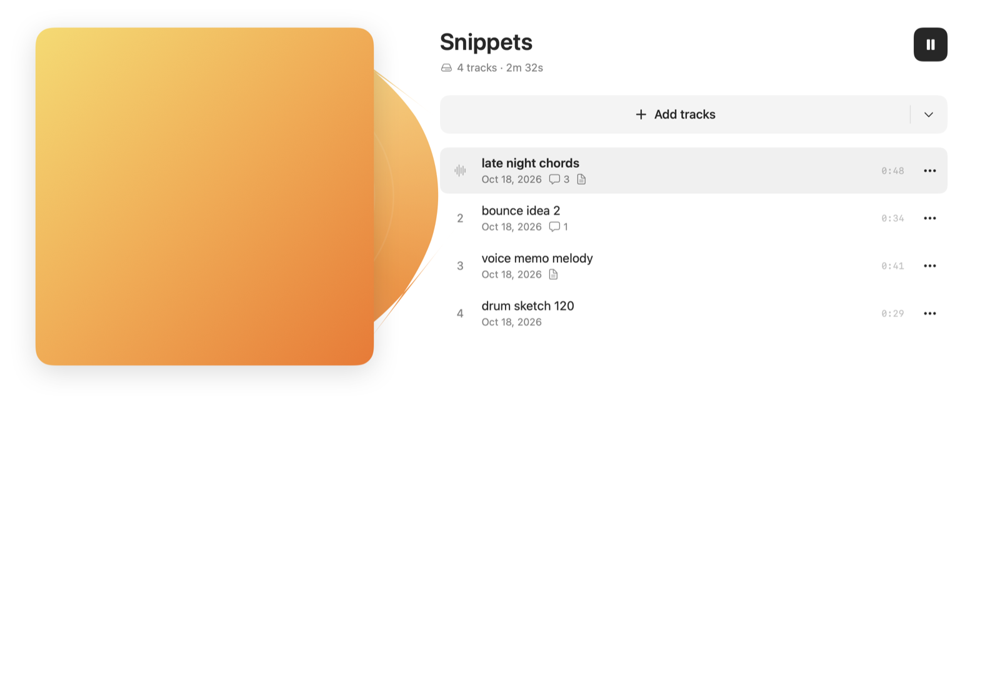
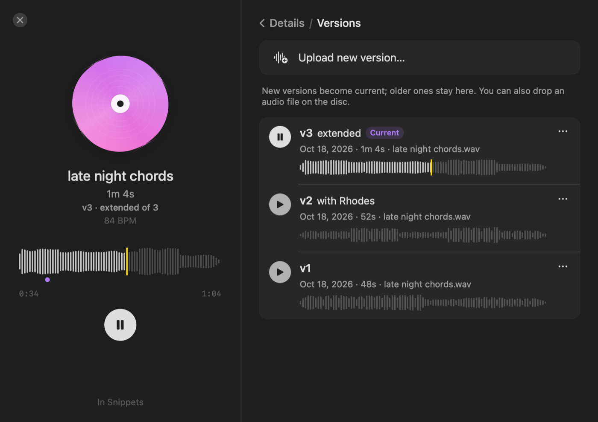
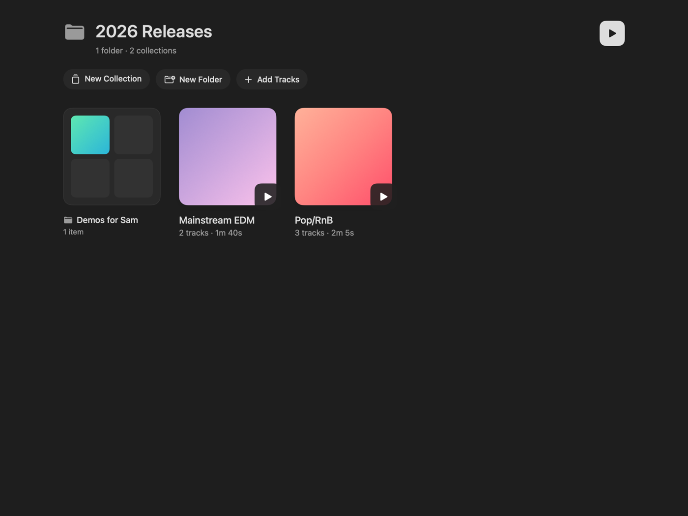
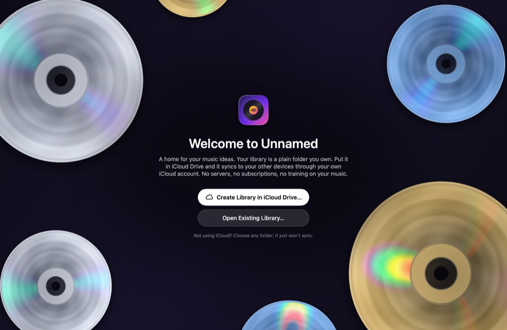

# Unnamed

An open-source home for your music ideas: voice memos, bounces, sketches and demos. Upload audio, organize it into collections (albums, EPs, mixtapes), and play it back with a SoundCloud-style waveform. Leave timestamped comments and notes.

Your library is **a plain folder you own**. Put it in iCloud Drive and it syncs to your other devices through your own iCloud account. There's no server, no subscription, and nothing trains on your music.



| Version history | Folders | Welcome screen |
| --- | --- | --- |
|  |  |  |

## Features

- **Import** WAV, MP3, AIFF, M4A/AAC, FLAC, CAF, or anything else macOS can play. Use the Add Tracks button, drag files or whole folders into the window, drop them on the Dock icon, or use Open With.
- **Collections**: albums, EPs, mixtapes, sets of sketches. A track can be in several collections. Reorder by dragging, add tracks you've already uploaded, and move or duplicate tracks between collections.
- **Folders** for organizing collections, nested as deep as you like. Songs live in collections; folders hold collections and other folders. Drag things into folders in the sidebar or on a folder's page.
- **Version history**: upload a new version of a track and the old ones are kept. Play any version, name it ("rough mix", "with vocals"), make it current again, or export it. Comments belong to the version they were made on.
- **Artwork** for collections and individual tracks: click an empty cover or right-click → Cover Art to upload an image, drop one on the cover, or pick a photo from **Unsplash** (the photographer is credited under the cover). Tracks without their own art take on their collection's look.
- **Waveform player**: a floating player with a scrubbable waveform, play/pause, next/previous, shuffle, repeat (all/one), volume and an up-next queue. Media keys and Control Center work too.
- **Moodboards**: switch a collection to its moodboard (⇧⌘M, or the toggle in the toolbar) and the page zooms out into an infinite dot-grid canvas. Drag songs from the tray onto it: each gets a level title card and waveform, with a thin glass thread running underneath. Pull the thread anywhere to bend it, and lay the songs out as a map. Add pictures and videos (compressed to HEIC and HEVC as they go in), write, draw, and pick the background. **Play Journey** and a glass bead travels along each thread as its song plays, the thread filling with the song's colour behind it; the view follows, swoops to the next song when one ends, and brings what's near the bead into focus. Double-click a thread or a waveform to play from that point. ⌘-scroll or pinch to zoom, scroll in any direction to move, drag with the middle button to pan. Everything syncs as small files in the library folder.
- **Scratching**: grab the spinning disc (in the player, or the record behind a collection's cover) or drag along the waveform, and the music follows your hand like a DJ's, pitch, backwards and all. Grabbing brakes the record to a stop; letting go spins it back up and playback carries on, lined up to the sample. Dragging along the waveform at about playing speed plays the melody smoothly.
- **Timestamped comments**: start typing while a track plays and the comment pins to that moment (and that version). Comments show as markers on the waveform; click one to jump there.
- **Key and BPM detection**: drop in a song (or a new version) and the app listens for its tempo and key, which show in the track's details and are searchable. Typed values always win; Edit Track has "Detect from Audio", plus ½× and 2× for when a tempo lands on half or double time. File ▸ Find Missing Keys and Tempos fills in tracks added before. The detector is built in (Accelerate only, no GPL code), and its accuracy is measured against the Apple Loops that come with GarageBand.
- **Notes** per track, for lyrics, chords and to-dos.
- **Archive** tracks, collections and folders: out of sight, not deleted. Archived things leave Home, All Tracks, search and playback, and wait under Archived in the sidebar until you restore them to exactly where they were.
- **Search** across titles, file names, notes, comments, key and BPM.
- **iCloud aware**: tracks that aren't downloaded yet show a cloud badge and download when played. Use "Make available offline" / "Remove download" to manage space.
- **Export** a track (or any version), or a whole collection as numbered files. Drag a track straight into Finder or your DAW.
- **A Metal welcome screen**: slowly spinning CDs, drawn per pixel with a small diffraction model, whose rainbow sheen follows your mouse. The same shader draws the launch screen, the "+" button's open state and the app icon. On a collection's page, the playing record gets a lighter sheen of its own and spins up and coasts down with playback.
- **Liquid Glass** (macOS 26, on by default; Settings → Appearance): the player, buttons and toasts turn to glass, the window takes on the colours of the artwork you're looking at or listening to, a collection's play button and the playhead take their colour from the cover, a glass bead rides the playhead, and the "+" melts out of the player and opens into glass bubbles.
- **Light on the CPU**: the spinning discs, the scrolling title and the "now playing" waveform are animated by Core Animation, so playing music costs a few percent of one core, and the clock, the waveform and a moodboard redraw only when something would visibly change. **Low Power Mode** (Settings → Energy; automatic when your Mac is in Low Power Mode, or always on or off) stops the discs spinning, draws moodboards without glass and at a gentler frame rate, and updates the player a few times a second.

## Getting started

Requirements: macOS 15 or later, and Xcode 16 or later to build. Xcode 26 ships the Metal compiler separately; if the build says it's missing, run `xcodebuild -downloadComponent MetalToolchain`.

```sh
git clone <this repo>
open Unnamed.xcodeproj
```

Press Run. On first launch, choose **Create Library in iCloud Drive…** (or pick any folder if you don't want sync).

To try the app without your own files, add `-demoLibrary` under *Product › Scheme › Edit Scheme › Arguments* (Debug builds only). This opens a throwaway library of synthesized ideas.

### Signing

Out of the box the app is signed to run locally, with no Apple account needed. To sign with your own team (which also keeps macOS remembering your library folder between rebuilds), create `Config/Signing.local.xcconfig`, which git ignores:

```
DEVELOPMENT_TEAM = ABCDE12345
CODE_SIGN_IDENTITY = Apple Development
PRODUCT_BUNDLE_IDENTIFIER = com.yourname.Unnamed
```

A free Apple ID is enough. The app doesn't use CloudKit or any paid capability.

### Unsplash

The cover-art picker can browse Unsplash. Its API needs a free Access Key: create an app at [unsplash.com/developers](https://unsplash.com/developers). Either paste the key in the app's Settings, or build it in by adding `UNSPLASH_ACCESS_KEY = …` to `Config/Signing.local.xcconfig`.

The chosen photo is saved into your library as the cover (so it works offline and syncs), and the photographer is credited under it. Unsplash's API guidelines prefer apps to hotlink photos, which is fine for a personal demo key but should be revisited before applying for Unsplash production access.

### App icon

The icon is rendered from the CD shader itself. After changing the shader, run `Scripts/make-icon.sh` to regenerate every size.

## How sync works

The library is ordinary files (see [docs/LIBRARY_FORMAT.md](docs/LIBRARY_FORMAT.md)):

```
Unnamed Library/
  Tracks/<id>/        every version's audio, track.json, notes.md, Comments/*.json, Waveforms/*.json, artwork
  Collections/<id>/   collection.json (ordered track ids), artwork
  Folders/<id>/       folder.json (title and parent folder)
```

iCloud Drive moves the files between devices. The app watches the folder, picks up changes as they arrive, and writes through `NSFileCoordinator` the way iCloud expects. Each comment is its own file, and notes are separate from metadata, so edits made on two devices at once rarely touch the same file. When they do, the newest version wins.

Why not CloudKit? CloudKit needs a paid Apple Developer membership for every person who builds the app. It would also put your library in a database only this app can read. A folder works with a free account and stays readable without the app. You can back it up, move it, or share it as an iCloud Drive shared folder to collaborate.

## Project layout

```
Packages/UnnamedKit/   Platform-independent core, shared with the future iPhone app
  Models, LibraryLayout          the on-disk format
  LibraryDisk                    file I/O actor: coordinated writes, cached scans, conflicts
  LibraryStore (+Folders, +Versions)  observable in-memory library, mutations, sync
  AudioAnalyzer                  duration + waveform peaks
  PlaybackQueue, PlayerController  queue rules, AVPlayer, Now Playing
Unnamed/               macOS app (SwiftUI)
  App/        app entry, menus, AppModel (navigation, panels), debug helpers
  Views/      Home, collection page, track details, player bar, search, settings
  Components/ waveform, disc, artwork, drag and drop, layout, CD shader (Metal)
Config/                Info.plist, entitlements, signing
```

Run the core tests:

```sh
cd Packages/UnnamedKit && swift test
```

The Xcode project uses synchronized folders, so new files under `Unnamed/` are picked up without editing the project.

## Roadmap

- iPhone app sharing `UnnamedKit` (opens the same iCloud Drive folder)
- Recording straight into the app
- Sharing a collection by link
- Optional CloudKit backend for people with a developer account

## License

MIT. See [LICENSE](LICENSE).
